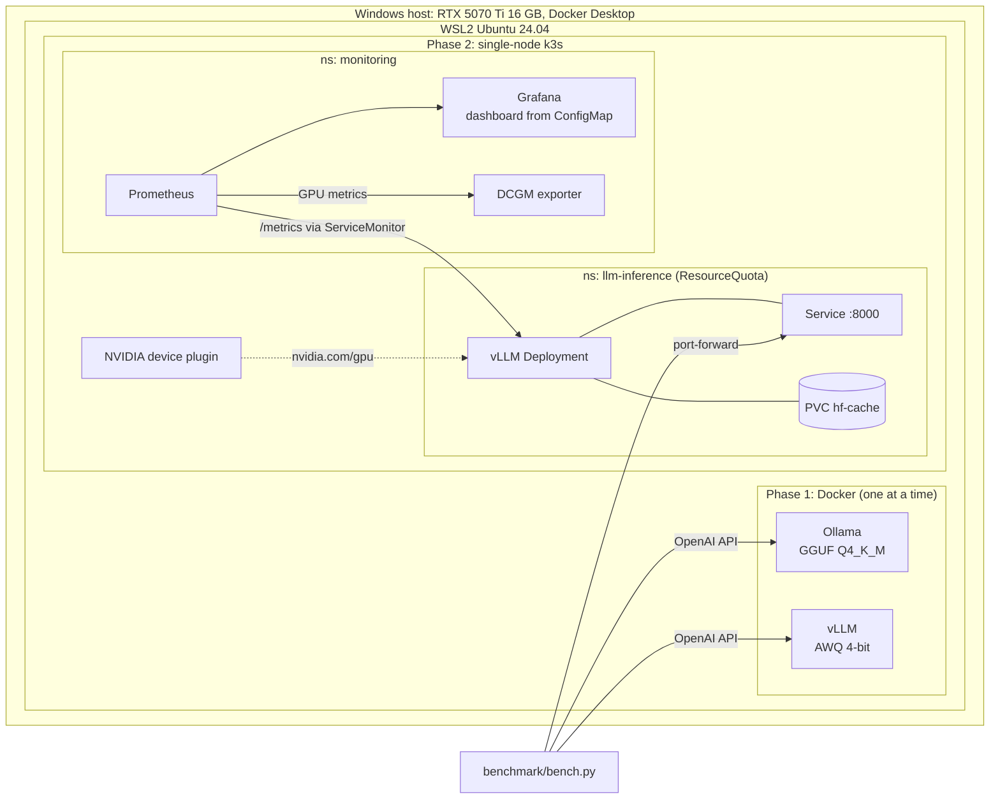

# Self-hosted LLM inference lab

A small, measured study of serving an open-weight LLM on a single consumer GPU: Ollama vs vLLM in Docker, then vLLM on a local Kubernetes (k3s) cluster with Prometheus and Grafana (including GPU metrics). Everything here was run on one machine on 2026-10-29; every number in this README comes from the result files in [`results/`](results/) or from [`LOG.md`](LOG.md), which records commands, versions and problems as they happened.

This is a learning/portfolio project for AI-infrastructure platform engineering. It is **not** a production platform, and the [limitations](#limitations) and [what I did not do](#what-i-did-not-do) sections are part of the result.

## What is in the repo

| Path | Contents |
|---|---|
| `docker/compose.yaml`, `scripts/start-runtime.sh` | Digest-pinned Ollama and vLLM services; the script runs one engine at a time on the GPU |
| `benchmark/` | Python benchmark client (OpenAI-compatible streaming API) and pytest tests for parsing and statistics |
| `results/` | Raw CSV/JSON output of every benchmark run (`results/k8s/` for in-cluster) |
| `k8s/vllm/` | Namespace + ResourceQuota, model-cache PVC, vLLM Deployment, Service |
| `k8s/monitoring/` | Helm values for kube-prometheus-stack and the DCGM exporter, vLLM ServiceMonitor, dashboard ConfigMap |
| `dashboards/` | Grafana dashboard JSON (11 panels) |
| `scripts/setup-k3s-wsl.sh` | Host setup (NVIDIA container toolkit, k3s, Helm); needs sudo, read before running |
| `docs/` | Write-up of problems worth knowing about |
| `.github/workflows/ci.yaml`, `Makefile` | CI (yamllint, pytest, kubeconform, helm lint) and reproduction targets |
| `LOG.md` | Chronological lab notebook |

## Architecture



## Environment (as observed)

| Item | Value |
|---|---|
| GPU | NVIDIA GeForce RTX 5070 Ti, 16,303 MiB |
| CPU / RAM | AMD Ryzen 7 9700X (16 logical CPUs); 15 GiB visible inside WSL2 |
| OS | Ubuntu 24.04.4 LTS on WSL2 2.7.11.0 (kernel 6.18.33.2-microsoft-standard-WSL2) |
| NVIDIA driver | KMD 610.88 (`nvidia-smi` 610.57.01), CUDA UMD 13.3 |
| Docker | Docker Desktop 4.84.0, Engine 29.6.2 |
| Ollama | 0.40.13 (`ollama/ollama@sha256:b2f0122c...`), model `qwen2.5:7b-instruct-q4_K_M` (GGUF Q4_K_M, 4.7 GB) |
| vLLM | 0.32.0 (`vllm/vllm-openai@sha256:befccf0e...`), model `Qwen/Qwen2.5-7B-Instruct-AWQ`, `--max-model-len 4096 --gpu-memory-utilization 0.80 --max-num-seqs 8` |
| Kubernetes | k3s v1.36.5+k3s1, containerd 2.3.4-k3s1.36, single node |
| NVIDIA stack | Container Toolkit 1.20.1, k8s-device-plugin chart 0.20.1 |
| Monitoring | kube-prometheus-stack chart 92.15.0, dcgm-exporter chart 4.8.4 (image tag 4.6.1-4.8.4-distroless), Helm v3.22.1 |
| Benchmark | Python 3.12.12, requests 2.34.2, pytest 9.2.0 |

## Methodology

`benchmark/bench.py` sends streaming chat-completion requests to an OpenAI-compatible endpoint using a fixed set of 8 prompts ([`benchmark/prompts.json`](benchmark/prompts.json)), 2 repeats per prompt (16 requests per concurrency level), `max_tokens=64`, at concurrency 1, 2, 4 and 8. After one warm-up request it records:

- **TTFT**: time to the first non-empty content delta.
- **Tokens/s**: completion tokens (from the server's `usage` block, not estimated) divided by time after the first token. This is *per request*, not aggregate throughput.
- **End-to-end latency** p50 (median) and p95 (nearest-rank) over successful requests; failures are counted separately (failure rate).
- **Peak VRAM**: maximum `nvidia-smi` memory use over the whole GPU while the level ran.

Only one engine used the GPU at a time. Each configuration was run **once**.

## Results

All values are from [`results/`](results/). Times in seconds; "Tok/s" is the per-request p50; VRAM is MiB for the whole GPU.

| Setup | Concurrency | OK | TTFT p50 | TTFT p95 | Tok/s p50 | E2E p50 | E2E p95 | Peak VRAM |
|---|---|---|---|---|---|---|---|---|
| Ollama 0.40.13, GGUF Q4_K_M (Docker) | 1 | 16/16 | 0.021 | 0.024 | 145.5 | 0.461 | 0.469 | 6234 |
| Ollama 0.40.13, GGUF Q4_K_M (Docker) | 2 | 16/16 | 0.467 | 0.477 | 145.6 | 0.905 | 0.917 | 6234 |
| Ollama 0.40.13, GGUF Q4_K_M (Docker) | 4 | 16/16 | 1.365 | 1.380 | 145.8 | 1.791 | 1.819 | 6234 |
| Ollama 0.40.13, GGUF Q4_K_M (Docker) | 8 | 16/16 | 3.136 | 3.191 | 145.6 | 3.575 | 3.596 | 6234 |
| vLLM 0.32.0, AWQ 4-bit (Docker) | 1 | 16/16 | 0.016 | 0.023 | 146.5 | 0.452 | 0.461 | 13486 |
| vLLM 0.32.0, AWQ 4-bit (Docker) | 2 | 16/16 | 0.021 | 0.025 | 149.7 | 0.448 | 0.454 | 13486 |
| vLLM 0.32.0, AWQ 4-bit (Docker) | 4 | 16/16 | 0.028 | 0.038 | 148.8 | 0.459 | 0.463 | 13486 |
| vLLM 0.32.0, AWQ 4-bit (Docker) | 8 | 16/16 | 0.035 | 0.043 | 148.0 | 0.467 | 0.475 | 13488 |
| vLLM 0.32.0, AWQ 4-bit (k3s, via port-forward) | 1 | 16/16 | 0.020 | 0.021 | 149.4 | 0.447 | 0.451 | 13588 |
| vLLM 0.32.0, AWQ 4-bit (k3s, via port-forward) | 2 | 16/16 | 0.027 | 0.029 | 151.6 | 0.444 | 0.539 | 13582 |
| vLLM 0.32.0, AWQ 4-bit (k3s, via port-forward) | 4 | 16/16 | 0.034 | 0.037 | 151.6 | 0.454 | 0.462 | 13582 |
| vLLM 0.32.0, AWQ 4-bit (k3s, via port-forward) | 8 | 16/16 | 0.049 | 0.052 | 150.6 | 0.473 | 0.478 | 13584 |

Other measured facts:

- vLLM engine initialisation (profile, KV cache, warm-up) took 93.56 s in Docker and 92.72 s in k3s (compilation 11.5 s / 11.3 s); KV cache 116,016 tokens at `--gpu-memory-utilization 0.80`. These are single observations.
- The first (warm-up) request to Ollama took 32.4 s to first token because the model had to be loaded; vLLM's warm-up request took 0.21 s once it was serving.

### Ollama vs vLLM

What the data show on this machine and workload (short prompts, 64 output tokens):

- **Single stream is a tie.** At concurrency 1 both engines generate at roughly 146 tokens/s with end-to-end latency near 0.45 s.
- **Concurrency is where they differ.** Ollama's TTFT p50 rose from 0.02 s to 3.14 s (concurrency 1 to 8) while its per-request tokens/s stayed flat at about 145; this pattern is consistent with requests being handled one after another. vLLM's TTFT p50 stayed between 0.016 and 0.035 s and its end-to-end p50 between 0.45 and 0.47 s. I did **not** investigate why Ollama behaved this way (for example its parallelism settings were left at defaults), so this is an observation about default behaviour, not a statement about what Ollama can do when tuned.
- **VRAM figures are not comparable.** vLLM pre-allocates memory according to `--gpu-memory-utilization`, so its 13.5 GiB reflects that setting, not what the model needs. Ollama's 6.2 GiB figure includes about 1 GiB already used by other processes before the run.

**Not apples-to-apples:**

- Different quantisation formats and kernels: GGUF Q4_K_M (llama.cpp backend) vs AWQ 4-bit (Marlin kernels in vLLM). Output quality was **not** compared.
- Different runtimes with different defaults (batching, KV-cache sizing, context length: vLLM was capped at 4,096 tokens).
- Short, fixed prompts and 64 output tokens only; no long-context or sustained-load test; one run per configuration, so no confidence intervals.

### Docker vs Kubernetes

vLLM in k3s gave similar numbers to Docker (TTFT p50 0.020 to 0.049 s vs 0.016 to 0.035 s; tokens/s p50 149 to 152 vs 146 to 150). The cluster run goes through `kubectl port-forward` and was run once, so I make no claim about which is faster.

### Start-up time, scale-to-zero and the weight cache

Measured with [`scripts/measure-k8s-startup.sh`](scripts/measure-k8s-startup.sh) and [`scripts/measure-docker-startup.sh`](scripts/measure-docker-startup.sh); raw data in [`results/startup/`](results/startup/). "Seconds" is wall-clock time from the scale-up (or `docker run`) until the first successful chat completion.

| Case | Seconds |
|---|---|
| k3s, scale 0 to 1, weights already in PVC (3 runs) | 144.8, 134.6, 143.8 |
| Docker, weights already in volume (1 run) | 138.1 |
| Docker, empty volume: weights downloaded from Hugging Face (1 run) | 7302.2 |

The empty-cache figure is almost entirely download time (5.2 GB), so it mostly measures this machine's network at that moment, not vLLM. It varied a lot: an earlier, aborted attempt (script bug, not reported as a result) had its weights loaded roughly 40 minutes after starting, judging from log timestamps. Treat the cold number as one observation, not a typical value. Both Docker figures exclude the image pull (image already present).

- Scaling the Deployment to 0 took 3.4 to 7.9 s (pod gone). The pod became Ready within about 0.4 s of the first successful completion in every run.
- With a warm cache, a cold pod therefore costs a little over 2 minutes before it can serve. The engine log shows about 93 s of that is vLLM's own initialisation (profiling, KV-cache allocation, warm-up), which a PVC cache does not remove; I did not separately time the remaining seconds (container start, weight load).
- I did not try KEDA or Knative, so there is no request-driven scale-from-zero here: the scaling was done by hand with `kubectl scale`.
- The empty-cache case could only be measured in Docker, because pods in this cluster could not download weights (see [`docs/pod-network-download-issue.md`](docs/pod-network-download-issue.md)). An in-cluster empty-cache number does not exist.

### Monitoring

Prometheus scrapes vLLM's `/metrics` (a ServiceMonitor) and the DCGM exporter. The dashboard ([`dashboards/llm-inference.json`](dashboards/llm-inference.json)) has panels for e2e latency, TTFT, inter-token latency, tokens/s, requests/s, running vs waiting requests, KV-cache usage, and GPU utilisation, memory, temperature and power. I verified the dashboard loaded into Grafana and that each panel's query returned data after a load run; I did not capture screenshots.

## How to reproduce

Prerequisites you must provide: a Windows + WSL2 (Ubuntu 24.04, systemd enabled) machine with an NVIDIA GPU and driver supporting CUDA on WSL, Docker Desktop with WSL integration and GPU support, `python3` and `make`. Review [`scripts/setup-k3s-wsl.sh`](scripts/setup-k3s-wsl.sh) (uses sudo) before running it.

```bash
# Phase 1 (one engine at a time; Ollama is published on host port 11435)
python3 -m venv .venv && . .venv/bin/activate && pip install -r benchmark/requirements.txt
make docker-ollama && make bench-ollama
make docker-vllm   # wait until http://localhost:8000/v1/models responds, then:
make bench-vllm

# Phase 2
./scripts/setup-k3s-wsl.sh        # NVIDIA toolkit, k3s, Helm
make k8s-gpu-plugin k8s-vllm k8s-monitoring k8s-dashboard
make bench-k8s
make grafana-password             # then: kubectl -n monitoring port-forward svc/kps-grafana 3000:80

# Checks (also run in CI)
make test lint helm-validate
```

Note: the Makefile targets were written from the commands I ran by hand; I could not run `make` itself on my machine (it is not installed there), although CI runs `make helm-validate`.

## Lessons learned

- **Check what is already on the port.** A system `ollama.service` already held port 11434, so the Docker container silently looked fine while requests hit a different Ollama version. Publishing on 11435 and verifying the version string fixed it.
- **Helm chart docs can be stale.** The device-plugin README showed chart 0.17.1; the repo had 0.20.1. Query the repo, not the page.
- **The device plugin did not schedule on this node** until I added the `nvidia.com/gpu.present=true` label, because it relies on Node Feature Discovery labels that this cluster lacks.
- **A Service named `vllm` injects `VLLM_*` environment variables** that collide with vLLM's own settings; `enableServiceLinks: false` avoids that.
- **Prometheus silently drops a ServiceMonitor whose `scrapeTimeout` exceeds its interval.** The DCGM chart default (25 s) did exactly that; the operator log, not Prometheus, told me.
- **Model downloads from pods failed** here (see below), so weights had to be pre-loaded into the PVC.
- DCGM exporter works on WSL2 with this GPU, which I had not expected.

## Limitations

- Single machine, single GPU, single node; one run per configuration; small prompt set; short outputs.
- WSL2 networking and GPU virtualisation may differ from a bare-metal Linux cluster, so absolute numbers may not transfer.
- Benchmark client and server share the same machine (CPU contention possible).
- Output quality was not evaluated, only speed.
- Peak VRAM is whole-GPU memory sampled with `nvidia-smi`, including other processes.
- Host-level metrics (node-exporter) are disabled; its image would not pull.

## What I did not do

- **Stretch goals C and D** (GPU time-slicing, MCP server with tool calling) are **not done**. Goal A (cache) was measured only in Docker, and goal B (scale-to-zero) only by manual `kubectl scale`, without KEDA or Knative.
- I did not diagnose why pods could not download from Hugging Face ([`docs/pod-network-download-issue.md`](docs/pod-network-download-issue.md)). The weights were copied from the Docker volume into the PVC and vLLM runs with `HF_HUB_OFFLINE=1`, so a network cold start in the cluster was never measured.
- I did not investigate Ollama's concurrency behaviour or tune it.
- I did not compare the same quantisation format across engines, or measure output quality.
- No multi-node, multi-GPU, multi-tenant, authentication, TLS, autoscaling or alerting setup (Alertmanager is disabled).
- No screenshots of the dashboard.
- Did not run `make` locally (not installed); the underlying commands were run individually.

## How this maps to a sovereign multi-tenant platform

This lab is a single-user, single-node sketch; it does **not** implement any of the following. What a platform at scale would need on top:

- **Federation:** multiple clusters (possibly across institutions) behind a common control plane and model catalogue, with placement that respects data-residency rules; this needs cluster-API/GitOps tooling and cross-cluster identity, none of which is here.
- **Tenant isolation:** namespaces with ResourceQuota (used here, for one namespace) are the starting point; real isolation also needs NetworkPolicies, RBAC per tenant, separate or MIG/vGPU-partitioned GPUs (time-slicing does not isolate GPU memory), per-tenant storage and secrets.
- **Quotas and fair use:** per-tenant GPU/token budgets, admission control and queueing, plus scale-to-zero and weight caching to use scarce GPUs efficiently (the PVC cache here is a minimal version of that idea; the effect was not measured).
- **Authentication and authorisation:** an API gateway with OIDC/institutional SSO, per-tenant API keys and audit logs in front of the inference endpoints (vLLM is unauthenticated here).
- **Multi-tenant observability:** per-tenant metric and log separation (for example tenant-labelled series and per-tenant dashboards/access control in the observability backend), retention and data-sovereignty controls. Here there is one Prometheus and one Grafana dashboard.
- **Bring-your-own-model:** a vetted path for tenants to deploy their own weights (image scanning, size limits, resource profiles).

## License

MIT, see [`LICENSE`](LICENSE).
